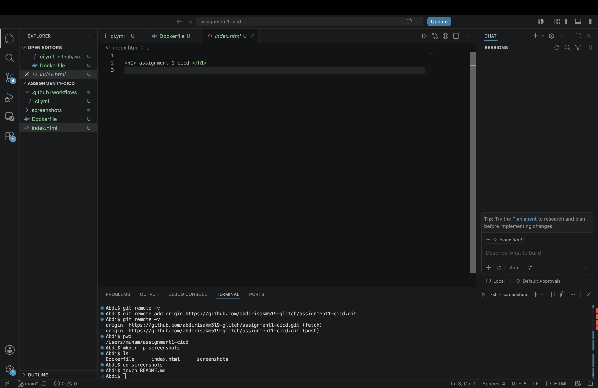
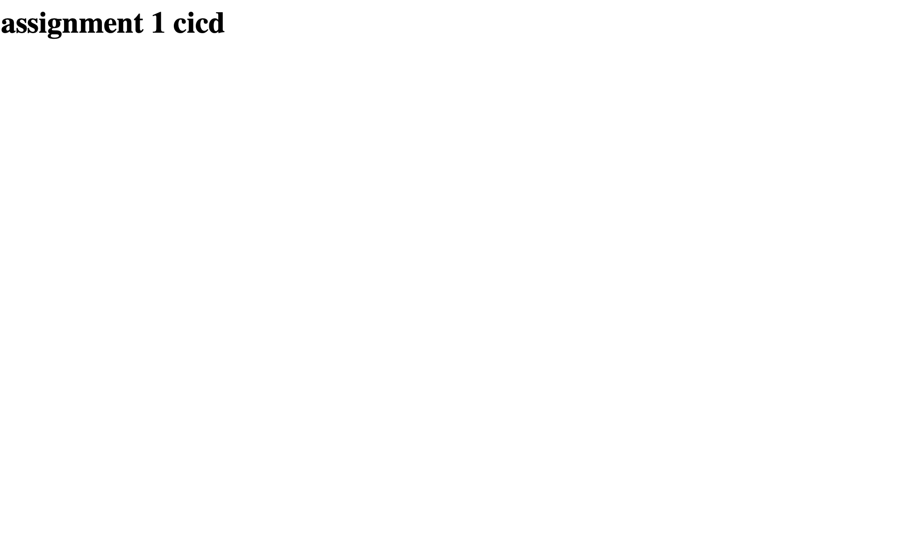
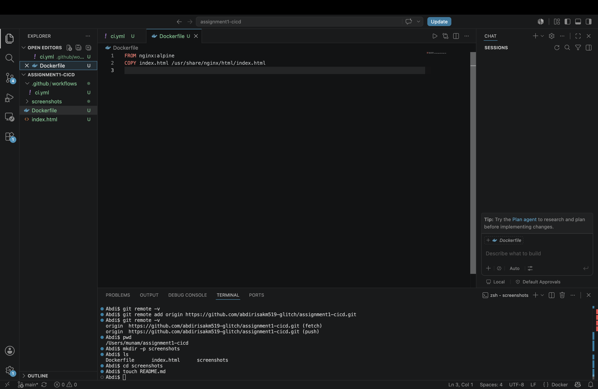
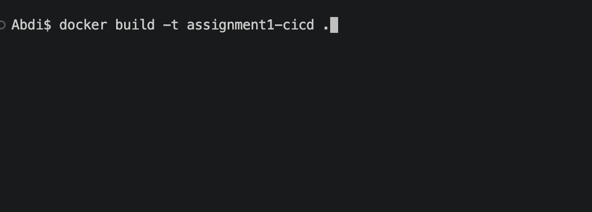
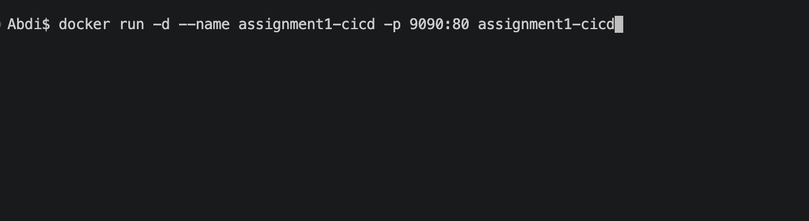
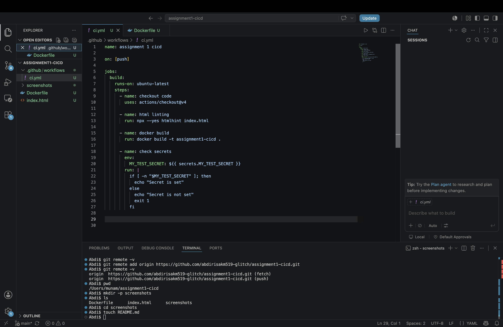
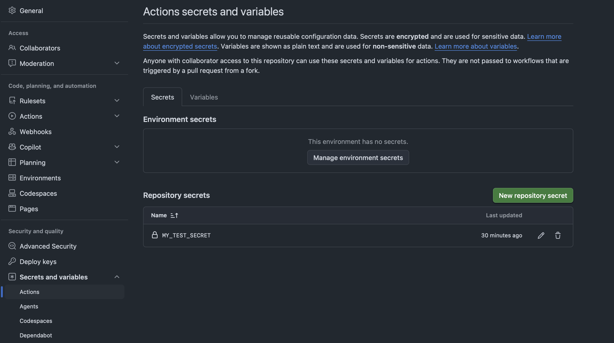
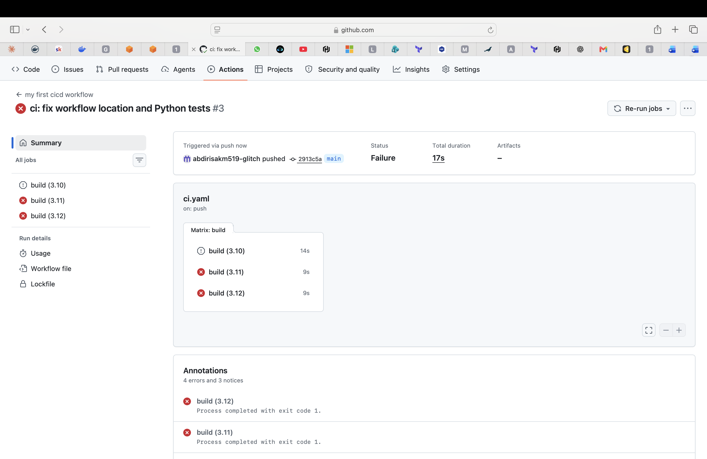

# CI/CD Assignment 1 — Automated CI Pipeline

## Project Overview

This project demonstrates a basic **Continuous Integration (CI) pipeline** using GitHub Actions.

I created a simple HTML webpage, served it locally using **Nginx and Docker**, and configured GitHub Actions to perform automated checks whenever I push code to GitHub.

The CI pipeline performs four steps:

1. Checks out the repository code.
2. Runs HTMLHint to check `index.html` for common HTML errors.
3. Builds the Docker image to verify the Dockerfile works.
4. Checks that a practice GitHub Secret is available through an environment variable.

**GitHub Repository:** https://github.com/abdirisakm519-glitch/assignment1-cicd

**GitHub Actions:** https://github.com/abdirisakm519-glitch/assignment1-cicd/actions

---

## Technologies Used

| Technology | Purpose |
|---|---|
| Git | Track and manage code changes |
| GitHub | Host the project repository |
| GitHub Actions | Automate CI checks on every push |
| Docker | Build images and run containers |
| Nginx | Serve the HTML webpage |
| HTML | Create the webpage |
| HTMLHint | Detect common HTML errors |
| GitHub Secrets | Store sensitive configuration |
| Environment Variables | Make configuration available to workflow steps |
| Visual Studio Code | Write and edit project files |

---

## Project Structure

```text
assignment1-cicd/
├── .github/
│   └── workflows/
│       └── ci.yml
├── screenshots/
│   ├── ci-workflow.png
│   ├── dockerfile.png
│   ├── html-code.png
│   ├── nginx-webpage.png
│   ├── docker-build.png
│   ├── docker-run.png
│   ├── github-actions-secrets.png
│   └── github-actions.png
├── Dockerfile
├── index.html
└── README.md
```

All screenshots are stored inside the `screenshots` directory.

The `README.md` file is stored in the main project directory so that the image links work correctly on GitHub.

---

## 1. HTML Webpage

I created an `index.html` file containing a heading for CI/CD Assignment 1.

During testing, HTMLHint detected that my original HTML file was missing the required `<!DOCTYPE html>` declaration.

I corrected the HTML document structure to resolve the linting error.

### HTML Source Code



### Running Nginx Webpage

After building and running the Docker container, I accessed my webpage at:

http://localhost:9090



---

## 2. Docker Configuration

I created a Dockerfile to package my HTML webpage using Nginx.

### Dockerfile

```dockerfile
FROM nginx:alpine
COPY index.html /usr/share/nginx/html/index.html
```

### Dockerfile Explanation

- `FROM nginx:alpine` selects the lightweight Nginx Alpine base image.
- `COPY` copies my local `index.html` into the Nginx webpage directory inside the Docker image.

### Dockerfile Screenshot



### Building the Docker Image

I ran:

```bash
docker build -t assignment1-cicd .
```

This command builds the Docker image using my Dockerfile.

- `docker build` creates the image.
- `-t assignment1-cicd` names the image.
- `.` tells Docker to use the current project directory as the build context.

### Docker Build Screenshot



### Running the Docker Container

I started the container using:

```bash
docker run -d --name assignment1-cicd -p 9090:80 assignment1-cicd
```

Explanation:

- `docker run` creates and starts a container.
- `-d` runs it in the background.
- `--name assignment1-cicd` assigns the container a name.
- `-p 9090:80` maps port 9090 on my Mac to port 80 inside the Nginx container.
- The final `assignment1-cicd` specifies the image to run.

### Docker Run Screenshot



### Updating the Docker Image

After changing my HTML file, I needed to rebuild the Docker image.

This is because Docker's `COPY` instruction includes the HTML content when the image is built.

I used:

```bash
docker build -t assignment1-cicd .
```

I then stopped and removed the existing container:

```bash
docker stop assignment1-cicd
docker rm assignment1-cicd
```

Finally, I created a new container from the updated image:

```bash
docker run -d --name assignment1-cicd -p 9090:80 assignment1-cicd
```

This allowed the container to serve the updated webpage.

---

## 3. GitHub Actions CI Pipeline

I created a GitHub Actions workflow at:

`.github/workflows/ci.yml`

The purpose of this workflow is to automatically check my project whenever I push code to GitHub.

### CI Workflow Configuration

```yaml
name: assignment 1 cicd

on: [push]

jobs:
  build:
    runs-on: ubuntu-latest
    steps:
      - name: checkout code
        uses: actions/checkout@v4

      - name: html linting
        run: npx --yes htmlhint index.html

      - name: docker build
        run: docker build -t assignment1-cicd .

      - name: check secrets
        env:
          MY_TEST_SECRET: ${{ secrets.MY_TEST_SECRET }}
        run: |
          if [ -n "$MY_TEST_SECRET" ]; then
            echo "Secret is set"
          else
            echo "Secret is not set"
            exit 1
          fi
```

### How the CI Pipeline Works

#### Step 1 — Automatic Push Trigger

```yaml
on: [push]
```

This tells GitHub Actions to automatically execute the workflow whenever code is pushed to the repository.

#### Step 2 — Checkout Repository

```yaml
uses: actions/checkout@v4
```

This makes the repository files available on the GitHub Actions runner.

#### Step 3 — HTML Linting

```yaml
run: npx --yes htmlhint index.html
```

HTMLHint checks the HTML file for common mistakes and coding-standard issues.

If HTMLHint identifies an error, the step fails and GitHub Actions reports the failure.

#### Step 4 — Docker Build Check

```yaml
run: docker build -t assignment1-cicd .
```

This checks whether Docker can successfully build my application image.

The workflow builds the image but does not deploy it or start a container.

#### Step 5 — GitHub Secret Check

The final step verifies that my practice GitHub Secret is available.

If the secret is missing, the step fails.

### GitHub Actions Workflow Screenshot



---

## 4. GitHub Secrets and Environment Variables

I created a practice GitHub Secret named:

`MY_TEST_SECRET`

I configured the secret using:

**GitHub Repository → Settings → Secrets and variables → Actions**

The workflow retrieves the secret using:

```yaml
env:
  MY_TEST_SECRET: ${{ secrets.MY_TEST_SECRET }}
```

### Explanation

- `env:` defines an environment variable for the workflow step.
- `${{ secrets.MY_TEST_SECRET }}` retrieves the stored value from GitHub Secrets.
- `$MY_TEST_SECRET` accesses the variable inside the shell command.

The workflow checks whether the variable contains a value.

If it exists, the workflow prints:

```text
Secret is set
```

If it is missing, the step prints:

```text
Secret is not set
```

and uses `exit 1` to fail the step.

The actual secret value is never printed.

This secret check was included as an additional learning exercise. The static Nginx webpage does not require a secret to build or run.

### GitHub Secrets Screenshot



---

## 5. Troubleshooting and Debugging

During the assignment, I encountered several issues that helped me understand Docker, Git, and GitHub Actions.

### Issue 1 — Empty Dockerfile

When I first attempted to build my Docker image, Docker displayed:

```text
the Dockerfile cannot be empty
```

**Cause:** I had created the Dockerfile but had not added the required instructions.

**Solution:** I added the `FROM` and `COPY` instructions and rebuilt the image.

### Issue 2 — Incorrect Docker COPY Path

My initial `COPY` instruction referenced the wrong source path.

I corrected it to:

```dockerfile
COPY index.html /usr/share/nginx/html/index.html
```

This copies the local HTML file into the correct location inside the image.

### Issue 3 — Docker Port Conflict

When running my container, Docker reported:

```text
port is already allocated
```

Port 8080 was already being used.

**Solution:** I changed the host port to 9090 while keeping Nginx on port 80:

```bash
docker run -d --name assignment1-cicd -p 9090:80 assignment1-cicd
```

This allowed my webpage to run locally.

### Issue 4 — HTML Linting Failure

My initial GitHub Actions run failed during HTML linting.

HTMLHint displayed:

```text
Doctype must be declared before any non-comment content.
```

**Cause:** My original `index.html` was missing the HTML5 DOCTYPE declaration.

**Solution:** I updated the HTML document to include the required declaration and proper document structure.

This demonstrated how an automated CI pipeline can detect coding problems.

### Issue 5 — Untracked Git Files

My initial Git push did not include some important project files.

Using:

```bash
git status
```

I discovered that `.github/`, `Dockerfile`, and `index.html` were untracked.

**Solution:** I staged the files, committed them, and pushed the changes to GitHub.

### Issue 6 — README Screenshot Paths

Some README images did not display correctly.

The README was located inside the `screenshots` folder, causing the relative image paths to point to the wrong location.

**Solution:** I moved `README.md` to the project root and checked that the screenshot filenames matched the Markdown links.

---

## 6. Git Commands Used

I used Git to track and upload my assignment.

### Check Repository Status

```bash
git status
```

Shows modified, staged, and untracked files.

### Stage Changes

```bash
git add .
```

Stages the project changes for the next commit.

### Commit Changes

```bash
git commit -m "Update CI/CD assignment"
```

Saves the staged changes in the local Git repository.

### Push to GitHub

```bash
git push
```

Uploads my commits to the GitHub repository.

Because my workflow uses `on: [push]`, pushing a commit automatically starts the CI pipeline.

---

## 7. GitHub Actions Execution Evidence

My CI workflow is configured to perform these checks:

1. Checkout repository code
2. HTML linting using HTMLHint
3. Docker image build
4. GitHub Secret availability check

The workflow runs automatically whenever code is pushed to GitHub.

### GitHub Actions Screenshot



**GitHub Actions Runs:**

https://github.com/abdirisakm519-glitch/assignment1-cicd/actions

The latest workflow run should be checked to confirm that all steps have passed successfully.

---

## 8. What I Learned

Through this assignment, I gained practical experience in:

- Creating and organizing a GitHub repository
- Using Git for version control
- Writing HTML source code
- Creating a Dockerfile
- Understanding Docker images and containers
- Building Docker images
- Running Docker containers locally
- Understanding Docker port mapping
- Resolving Docker port conflicts
- Rebuilding images after source-code changes
- Creating GitHub Actions workflows
- Writing YAML with correct indentation
- Configuring automatic push triggers
- Adding HTML linting to a CI pipeline
- Debugging failed GitHub Actions runs
- Using GitHub Secrets securely
- Accessing secrets through environment variables
- Organizing project evidence screenshots
- Writing a professional Markdown README

---

## Conclusion

This assignment demonstrates the implementation of a basic Continuous Integration pipeline using GitHub Actions, Docker, Nginx, and HTMLHint.

I created an HTML webpage, packaged it in a Docker image, and tested it locally using an Nginx container.

I also configured GitHub Actions to automatically run HTML linting, Docker build checks, and a practice GitHub Secret check whenever code is pushed to the repository.

Throughout the assignment, I gained hands-on experience identifying and resolving errors in Docker, Git, HTML, and CI workflows.

The project helped me understand how automated CI checks can detect problems early and support a more reliable development process.

---

## Repository Links

**GitHub Repository:**

https://github.com/abdirisakm519-glitch/assignment1-cicd

**GitHub Actions:**

https://github.com/abdirisakm519-glitch/assignment1-cicd/actions